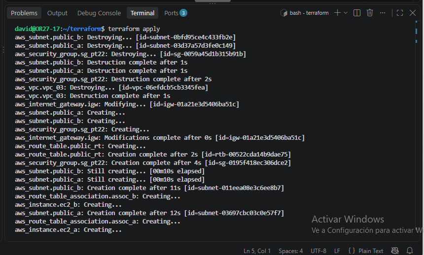
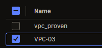
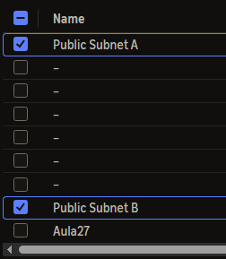
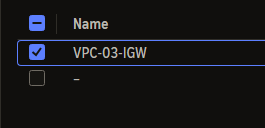
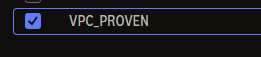
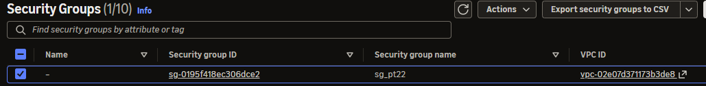
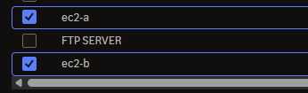

# Pt2.2 – Infraestructura bàsica a AWS amb Terraform

**Alumne:** David Bautista
**Grup:** ASIX2 – Mòdul OPT: Cloud Computing

## 1. Descripció

Infraestructura a AWS (regió `us-east-1`) desplegada amb Terraform:

- VPC `VPC-03` (10.0.0.0/16)
- Public Subnet A (10.0.1.0/24, us-east-1a) i Public Subnet B (10.0.2.0/24, us-east-1b), amb IP pública automàtica
- Internet Gateway i taula de rutes pública (0.0.0.0/0 → IGW) associada a les dues subxarxes
- Security Group: SSH des de qualsevol lloc, ICMP només des de la VPC, tot el trànsit sortint permès
- 2 instàncies EC2 `t3.micro` (Amazon Linux 2023), `ec2-a` i `ec2-b`, amb la clau `vockey`

## 2. Explicació del codi (`main.tf`)

**Provider**
Defineix que Terraform treballarà amb AWS i en quina regió (`us-east-1`). Sense aquest bloc, Terraform no sap on crear els recursos.

**VPC**
Crea la xarxa privada virtual on viuran tots els recursos. Té un rang d'adreces IP (CIDR), per exemple `10.0.0.0/16`.

**Subnets**
Divideixen la VPC en xarxes més petites. La subnet pública (`10.0.1.0/24`) té sortida a Internet i és on es posa la instància.

**Internet Gateway (IGW)**
És la porta d'entrada i sortida a Internet de la VPC. S'adjunta a la VPC perquè els recursos de la subnet pública es puguin comunicar amb l'exterior.

**Route table**
Conté les regles de ruta. Hi ha una ruta `0.0.0.0/0` cap a l'IGW, que envia a Internet tot el trànsit que no és de la VPC. Després s'associa a la subnet pública.

**Security group**
Actua com a tallafocs de la instància. Permet el trànsit d'entrada pels ports necessaris (per exemple SSH `22`) i deixa sortir tot el trànsit.

**Instància EC2**
És la màquina virtual. Indica l'AMI, el tipus d'instància (`t2.micro`), la subnet, el security group i la clau (`vockey`) per connectar-s'hi per SSH.


## 3. Desplegament

```bash
terraform init
terraform validate
terraform plan
terraform apply
```



## 4. Comprovacions

### VPC


### Subxarxes


### Internet Gateway i taula de rutes



### Security Group


### Instàncies EC2


