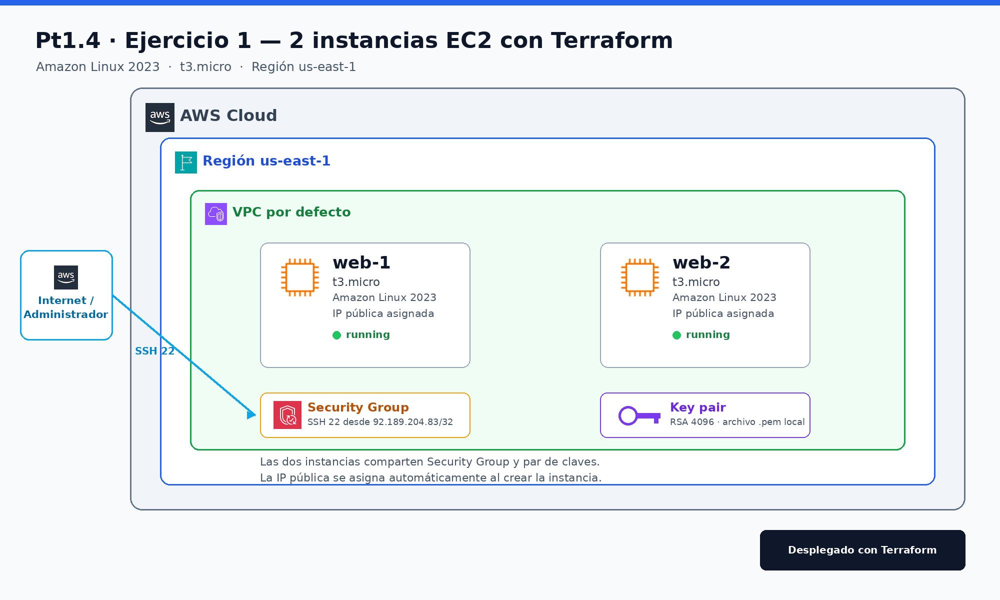

# Pt1.4 — Ejercicio 1: Primeras instancias EC2 con Terraform

## Datos

- **Alumno:** David Bautista
- **Módulo:** OPT Cloud Computing
- **Grupo:** ASIX2
- **Práctica:** Pt1.4
- **Ejercicio:** 1

## Objetivo

Iniciarse en la Infraestructura como Código (IaC) creando con Terraform dos instancias EC2 de Amazon Linux 2023 en la región `us-east-1`.

## Topología



El diagrama editable se encuentra en [`assets/topologia.drawio`](assets/topologia.drawio).

## Recursos creados

| Recurso | Nombre | Configuración |
| --- | --- | --- |
| Instancia EC2 1 | `pt1-4-ex1-web-1` | `t3.micro`, Amazon Linux 2023, IP pública |
| Instancia EC2 2 | `pt1-4-ex1-web-2` | `t3.micro`, Amazon Linux 2023, IP pública |
| Security Group | `pt1-4-ex1-ssh` | SSH (22/TCP) desde `92.189.204.83/32` |
| Key pair | `pt1-4-ex1-key` | RSA 4096, clave privada local `.pem` |
| VPC | VPC por defecto | La que proporciona AWS en la cuenta |
| AMI | Amazon Linux 2023 | Seleccionada dinámicamente con `data "aws_ami"` |

Las dos instancias comparten el mismo Security Group y el mismo par de claves. La IP pública se asigna automáticamente.

## Estructura

```text
pt1-4-ex1/
├── assets/
│   ├── topologia.drawio
│   └── topologia.png
├── main.tf
└── README.md
```

## Requisitos

- Terraform `>= 1.5`
- Credenciales de AWS con permisos para crear instancias EC2, Security Groups y Key Pairs
- Región `us-east-1`
- La cuenta debe tener la VPC por defecto disponible
- Acceso a Internet para descargar el provider de AWS durante `terraform init`

## Configuración

Las variables principales están declaradas al inicio de `main.tf`:

| Variable | Valor por defecto | Descripción |
| --- | --- | --- |
| `aws_region` | `us-east-1` | Región de AWS |
| `project_name` | `pt1-4-ex1` | Prefijo de nombres y etiquetas |
| `instance_type` | `t3.micro` | Tipo de instancia |
| `instance_count` | `2` | Número de instancias |
| `ssh_cidr` | `92.189.204.83/32` | IP autorizada para SSH |

Si tu IP pública cambia, actualiza `ssh_cidr` antes de aplicar los cambios:

```bash
terraform apply -var="ssh_cidr=TU_IP/32"
```

## Despliegue

```bash
cd pt1-4-ex1
terraform init
terraform fmt -check
terraform validate
terraform plan
terraform apply
```

Durante `terraform apply` se crearán las dos instancias y se generará el archivo `pt1-4-ex1-key.pem` con permisos `0600`.

## Verificación

Consulta las salidas:

```bash
terraform output
terraform output public_ips
terraform output ssh_commands
```

También puedes comprobar en la consola de AWS que las dos instancias están en estado `running`:

```text
EC2 → Instancias → Filtrar por etiqueta Project = pt1-4-ex1
```

### Conexión SSH

```bash
chmod 600 pt1-4-ex1-key.pem
ssh -i pt1-4-ex1-key.pem ec2-user@IP_PUBLICA
```

El usuario por defecto de Amazon Linux 2023 es `ec2-user`.

## Destrucción

Para eliminar los recursos y evitar costes:

```bash
cd pt1-4-ex1
terraform destroy
```

## Resultado del despliegue (28/10/2026)

`terraform apply` desplegó correctamente las dos instancias en `us-east-1`:

| Instancia | ID | IP pública | Estado |
| --- | --- | --- | --- |
| `pt1-4-ex1-web-1` | `i-0fbbb866fdfd6dd2c` | `100.59.190.130` | `running` |
| `pt1-4-ex1-web-2` | `i-043b959635b2c67d7` | `54.209.48.116` | `running` |

| Recurso | ID / nombre |
| --- | --- |
| Security Group | `sg-0e51ae7625ce89a4c` |
| Key pair | `pt1-4-ex1-key` |
| AMI Amazon Linux 2023 | `ami-04b938437b69a2c9c` |

## Validación realizada

```text
terraform fmt -check      → correcto
terraform init            → correcto
terraform validate        → Success! The configuration is valid.
terraform apply           → Apply complete! Resources: 2 added (instancias)
```

Las dos instancias quedaron en estado `running`. Tras comprobar el despliegue se ejecutó `terraform destroy` para no consumir crédito del laboratorio.

## Notas

- La clave privada `pt1-4-ex1-key.pem` y el estado de Terraform están excluidos del repositorio mediante `.gitignore`.
- El Security Group solo permite SSH desde la IP indicada; no se abre ningún otro puerto.
- Las instancias no instalan software adicional: el objetivo del ejercicio es la creación de la infraestructura básica.
- Al finalizar las pruebas, ejecuta `terraform destroy` para no consumir crédito del laboratorio.
