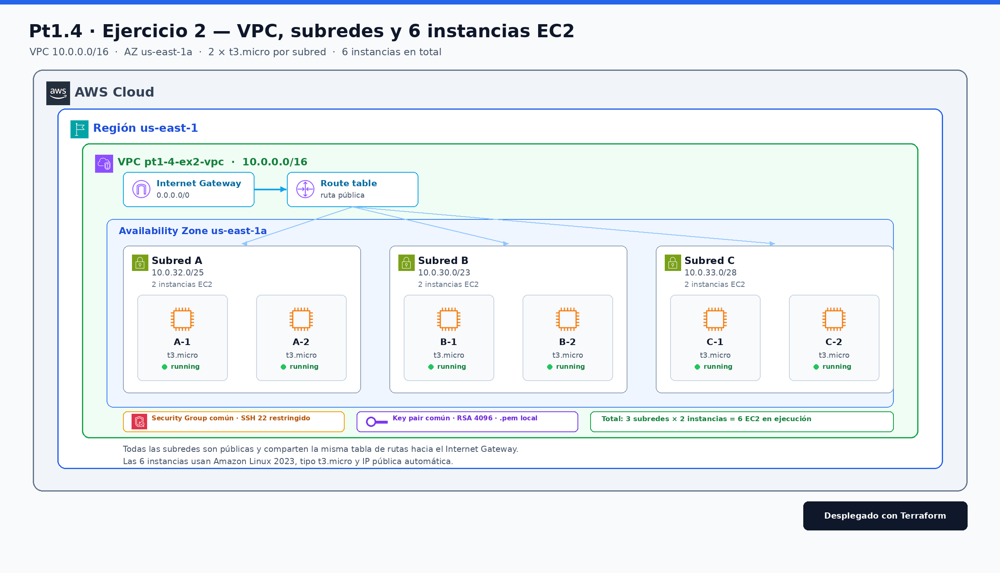
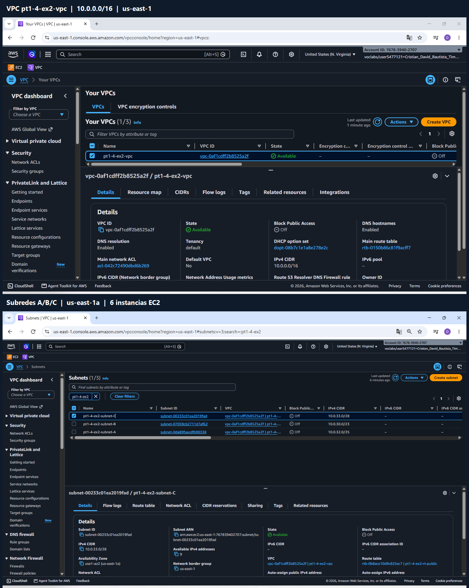
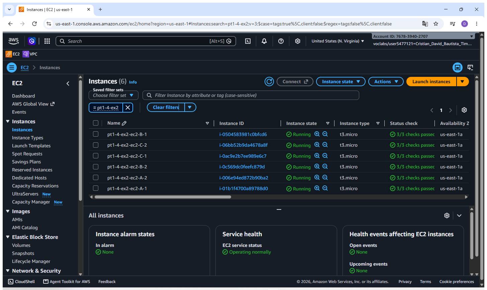

# Pt1.4 — Ejercicio 2: VPC, subredes y 6 instancias EC2

## Datos

- **Alumno:** David Bautista
- **Módulo:** OPT Cloud Computing
- **Grupo:** ASIX2
- **Práctica:** Pt1.4
- **Ejercicio:** 2

## Objetivo

Diseñar y desplegar una red segmentada en AWS con una VPC, tres subredes y seis instancias EC2, comparando el procedimiento manual en la consola de AWS con el despliegue automatizado mediante Terraform.

## Topología



El diagrama editable se encuentra en [`assets/topologia.drawio`](assets/topologia.drawio).

---

## Parte A — Diseño de la red

### VPC

| Recurso | Nombre | CIDR | Zona |
| --- | --- | --- | --- |
| VPC | `pt1-4-ex2-vpc` | `10.0.0.0/16` | `us-east-1` |

La VPC tiene activados el soporte DNS y los nombres de host DNS.

### Subredes

Todas las subredes están en la misma zona de disponibilidad, `us-east-1a`, y son públicas.

| Subred | Nombre | CIDR | Rango de direcciones | IPs reservadas por AWS | Instancias EC2 |
| --- | --- | --- | --- | --- | --- |
| A | `pt1-4-ex2-subnet-A` | `10.0.32.0/25` | `10.0.32.0` – `10.0.32.127` | 5 | 2 |
| B | `pt1-4-ex2-subnet-B` | `10.0.30.0/23` | `10.0.30.0` – `10.0.31.255` | 5 | 2 |
| C | `pt1-4-ex2-subnet-C` | `10.0.33.0/28` | `10.0.33.0` – `10.0.33.15` | 5 | 2 |

Las tres subredes se configuran con asignación automática de IP pública y comparten una tabla de rutas con salida a Internet a través de un Internet Gateway.

### Distribución de instancias

| Instancia | Subred | Tipo | Sistema operativo | IP pública |
| --- | --- | --- | --- | --- |
| `pt1-4-ex2-ec2-A-1` | A | `t3.micro` | Amazon Linux 2023 | Automática |
| `pt1-4-ex2-ec2-A-2` | A | `t3.micro` | Amazon Linux 2023 | Automática |
| `pt1-4-ex2-ec2-B-1` | B | `t3.micro` | Amazon Linux 2023 | Automática |
| `pt1-4-ex2-ec2-B-2` | B | `t3.micro` | Amazon Linux 2023 | Automática |
| `pt1-4-ex2-ec2-C-1` | C | `t3.micro` | Amazon Linux 2023 | Automática |
| `pt1-4-ex2-ec2-C-2` | C | `t3.micro` | Amazon Linux 2023 | Automática |

Total: **6 instancias EC2**.

---

## Parte B — Despliegue y comprobación en la consola de AWS

El enunciado pide desplegar la infraestructura manualmente desde la consola. Para evitar duplicar recursos y costes, las capturas de esta entrega se toman sobre la infraestructura creada por Terraform, que reproduce exactamente los mismos valores. El procedimiento manual equivalente es el siguiente.

### B.1. Crear la VPC

1. Consola de AWS → **VPC** → **Create VPC**.
2. Seleccionar **VPC only**.
3. Nombre: `pt1-4-ex2-vpc`.
4. IPv4 CIDR: `10.0.0.0/16`.
5. En **DNS settings**, activar **Enable DNS hostnames** y **Enable DNS support**.
6. Crear la VPC.

### B.2. Crear las tres subredes

Para cada subred:

1. **VPC** → **Subnets** → **Create subnet**.
2. Seleccionar la VPC `pt1-4-ex2-vpc`.
3. Introducir los valores de la tabla:

| Nombre | CIDR | AZ | Auto-assign public IPv4 |
| --- | --- | --- | --- |
| `pt1-4-ex2-subnet-A` | `10.0.32.0/25` | `us-east-1a` | Activado |
| `pt1-4-ex2-subnet-B` | `10.0.30.0/23` | `us-east-1a` | Activado |
| `pt1-4-ex2-subnet-C` | `10.0.33.0/28` | `us-east-1a` | Activado |

### B.3. Crear y asociar el Internet Gateway

1. **VPC** → **Internet gateways** → **Create internet gateway**.
2. Nombre: `pt1-4-ex2-igw`.
3. Crear y después **Attach to VPC** → seleccionar `pt1-4-ex2-vpc`.

### B.4. Crear la tabla de rutas pública

1. **VPC** → **Route tables** → **Create route table**.
2. Nombre: `pt1-4-ex2-rt-public`.
3. VPC: `pt1-4-ex2-vpc`.
4. En **Routes** → **Edit routes** → añadir:

| Destino | Target |
| --- | --- |
| `0.0.0.0/0` | `pt1-4-ex2-igw` |

5. En **Subnet associations**, asociar las tres subredes.

### B.5. Crear el Security Group

1. **EC2** → **Security groups** → **Create security group**.
2. Nombre: `pt1-4-ex2-ssh`.
3. VPC: `pt1-4-ex2-vpc`.
4. Regla de entrada:
   - Tipo: **SSH**
   - Puerto: **22**
   - Origen: **My IP** (o `92.189.204.83/32`)
5. Regla de salida: permitir todo el tráfico.
6. Crear el Security Group.

### B.6. Lanzar las seis instancias

Para cada una de las seis instancias:

1. **EC2** → **Instances** → **Launch instances**.
2. Nombre según la tabla de distribución.
3. AMI: **Amazon Linux 2023**.
4. Tipo: `t3.micro`.
5. Key pair: `pt1-4-ex2-key`.
6. Red: `pt1-4-ex2-vpc`.
7. Subred: la correspondiente (A, B o C).
8. Auto-assign public IP: **Enable**.
9. Security Group: `pt1-4-ex2-ssh`.
10. Lanzar.

### B.7. Capturas de pantalla

Las capturas deben mostrar:

1. **VPC y subredes:** VPC `pt1-4-ex2-vpc` con CIDR `10.0.0.0/16` y las tres subredes con sus CIDR.
2. **Instancias EC2:** listado filtrado por `Project = pt1-4-ex2` con las seis instancias en estado `running`.

Capturas reales tomadas el **28/10/2026** en la consola de AWS (`us-east-1`, cuenta AWS Academy `7678-3940-2707`) sobre la infraestructura desplegada:





Las capturas individuales también están disponibles en [`assets/vpc.png`](assets/vpc.png) y [`assets/subnets.png`](assets/subnets.png).

---

## Parte C — Despliegue con Terraform

### Estructura

```text
pt1-4-ex2/
├── assets/
│   ├── topologia.drawio
│   ├── topologia.png
│   ├── vpc.png
│   ├── subnets.png
│   ├── vpc_subnets.png
│   └── ec2_instances.png
├── main.tf
├── variables.tf
├── terraform.tfvars
└── README.md
```

### Variables principales (`variables.tf`)

| Variable | Valor por defecto | Descripción |
| --- | --- | --- |
| `aws_region` | `us-east-1` | Región de AWS |
| `project_name` | `pt1-4-ex2` | Prefijo de nombres y etiquetas |
| `vpc_cidr` | `10.0.0.0/16` | CIDR de la VPC |
| `availability_zone` | `us-east-1a` | AZ común a las tres subredes |
| `subnets` | A/B/C con sus CIDR | Mapa de subredes |
| `instance_type` | `t3.micro` | Tipo de instancia |
| `instances_per_subnet` | `2` | Instancias por subred |
| `ssh_cidr` | `92.189.204.83/32` | IP autorizada para SSH |

### Recursos declarados en `main.tf`

| Recurso | Descripción |
| --- | --- |
| `aws_vpc.this` | VPC principal `10.0.0.0/16` |
| `aws_internet_gateway.this` | Internet Gateway asociado a la VPC |
| `aws_subnet.this` | Tres subredes creadas con `for_each` |
| `aws_route_table.public` | Tabla de rutas con salida `0.0.0.0/0` al IGW |
| `aws_route_table_association.public` | Asociación de las tres subredes a la tabla |
| `aws_security_group.ssh` | SSH restringido a `ssh_cidr` |
| `tls_private_key.ssh` | Clave RSA 4096 |
| `local_sensitive_file.private_key` | Archivo `.pem` local con permisos `0600` |
| `aws_key_pair.ssh` | Key pair registrado en AWS |
| `aws_instance.this` | Seis instancias creadas con `for_each` |

### Uso de `for_each` y `locals`

Las subredes se crean recorriendo el mapa `var.subnets`:

```hcl
resource "aws_subnet" "this" {
  for_each = var.subnets

  vpc_id            = aws_vpc.this.id
  cidr_block        = each.value
  availability_zone = var.availability_zone
}
```

Las seis instancias se generan combinando cada subred con dos índices:

```hcl
locals {
  instances = merge([
    for subnet_key, subnet_cidr in var.subnets : {
      for index in range(var.instances_per_subnet) :
      "${subnet_key}-${index + 1}" => {
        subnet_key  = subnet_key
        subnet_cidr = subnet_cidr
        index       = index
      }
    }
  ]...)
}
```

De esta forma no hay valores duplicados ni recursos escritos a mano: si se añade una subred al mapa, Terraform crea automáticamente sus dos instancias.

### Salidas

```bash
terraform output vpc_id
terraform output subnet_ids
terraform output public_ips
terraform output ssh_commands
```

### Resultado real del despliegue (28/10/2026)

`terraform apply` creó **19 recursos** sin errores:

| Recurso | ID / valor |
| --- | --- |
| VPC | `vpc-0af1cdff2b8525a2f` — `10.0.0.0/16` |
| Subred A | `subnet-0da89faacdfb90338` — `10.0.32.0/25` |
| Subred B | `subnet-07059cb2711d7af62` — `10.0.30.0/23` |
| Subred C | `subnet-00233c01ea2019fad` — `10.0.33.0/28` |
| Internet Gateway | `igw-0805606392dd215dc` |
| Tabla de rutas | `rtb-0b8ace10d9c825ec7` |
| Security Group | `sg-0c6042ba3230836e9` |

| Instancia | Subred | ID | IP pública |
| --- | --- | --- | --- |
| `pt1-4-ex2-ec2-A-1` | A | `i-01b1f4700a89788d0` | `18.212.73.68` |
| `pt1-4-ex2-ec2-A-2` | A | `i-006e94ed872b90ba2` | `18.206.250.70` |
| `pt1-4-ex2-ec2-B-1` | B | `i-0504583981c0bfcd6` | `3.86.198.22` |
| `pt1-4-ex2-ec2-B-2` | B | `i-0c569dc0feefc879d` | `3.88.197.183` |
| `pt1-4-ex2-ec2-C-1` | C | `i-0ac9e2b7ee989e6c7` | `54.196.249.175` |
| `pt1-4-ex2-ec2-C-2` | C | `i-06bb52b9da4678a8f` | `13.222.49.62` |

Todas las instancias quedaron en estado `running` con **3/3 comprobaciones de estado superadas**. Las IPs públicas son las del momento de la captura y cambian si se vuelve a desplegar.

---

## Despliegue

```bash
cd pt1-4-ex2
terraform init
terraform fmt -check
terraform validate
terraform plan
terraform apply
```

Al finalizar se genera el archivo `pt1-4-ex2-key.pem` con permisos `0600`.

## Verificación

```bash
terraform output
```

En la consola de AWS:

```text
VPC → Your VPCs → pt1-4-ex2-vpc
VPC → Subnets → filtrar por VPC pt1-4-ex2-vpc
EC2 → Instances → filtrar por etiqueta Project = pt1-4-ex2
```

### Conexión SSH

```bash
chmod 600 pt1-4-ex2-key.pem
ssh -i pt1-4-ex2-key.pem ec2-user@IP_PUBLICA
```

## Destrucción

```bash
cd pt1-4-ex2
terraform destroy
```

## Validación realizada

```text
terraform fmt -check      → correcto
terraform init            → correcto
terraform validate        → Success! The configuration is valid.
terraform plan            → 19 to add, 0 to change, 0 to destroy
terraform apply           → Apply complete! Resources: 19 added
terraform destroy         → Destroy complete! Resources: 19 destroyed
```

El despliegue y las capturas se realizaron el **28/10/2026**. Al finalizar se destruyeron todos los recursos para no consumir crédito del laboratorio. Si vuelves a desplegar, ejecuta `terraform destroy` después de las comprobaciones.

## Notas de seguridad y costes

- La clave privada `pt1-4-ex2-key.pem`, el estado de Terraform y el directorio `.terraform/` están excluidos del repositorio.
- El Security Group solo permite SSH desde la IP indicada en `ssh_cidr`.
- Las subredes son públicas porque el ejercicio requiere acceso directo a las instancias; en un entorno real se separarían subredes públicas y privadas.
- Las seis instancias `t3.micro` consumen crédito del laboratorio. Ya se destruyeron tras las capturas; si vuelves a desplegar, ejecuta `terraform destroy` al terminar.
- Si la IP pública cambia, actualiza `ssh_cidr` en `terraform.tfvars` y vuelve a aplicar.
